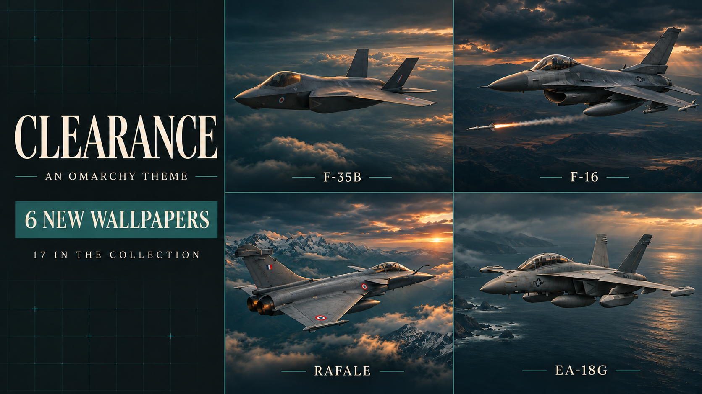

# Clearance

A dark Omarchy theme inspired by modern aviation: graphite surfaces, warm ivory text and muted teal accents, with sixteen aviation wallpapers.



*The cover is promotional artwork, not a screenshot of the desktop interface.*

## The theme

Clearance pairs a restrained interface with aircraft, cloudscapes, radar-inspired artwork and runway lights. It supplies a complete named colour palette, active and inactive window-border colours, and backgrounds. Omarchy generates its supported application colours from the palette. This theme does not install plugins, change your bar layout or supply executable scripts.

| Colour | Value |
|---|---|
| Graphite background | `#191f23` |
| Warm ivory text | `#dedbd2` |
| Muted teal accent | `#88b9b0` |
| Secondary text | `#929d9e` |

## Wallpaper collection

| Wallpaper | Scene |
|---|---|
| [Raptor](backgrounds/01-raptor-3440x1440.webp) | F-22-inspired aircraft above cloud |
| [Airspace](backgrounds/02-airspace-3440x1440.webp) | ATC-inspired radar artwork |
| [Flight Deck](backgrounds/03-flight-deck-3440x1440.webp) | Glass cockpit |
| [Above the Weather](backgrounds/04-above-the-weather-3440x1440.webp) | Aircraft and cloudscape |
| [Night Approach](backgrounds/05-night-approach-3440x1440.webp) | Runway lights |
| [Reference Plane](backgrounds/06-reference-plane-3440x1440.webp) | Aircraft surface study |
| [Nighthawk](backgrounds/07-nighthawk-f117-3440x1440.webp) | F-117-inspired aircraft |
| [Spirit](backgrounds/08-spirit-b2-3440x1440.webp) | B-2-inspired aircraft |
| [Typhoon](backgrounds/09-typhoon-3440x1440.webp) | Eurofighter-inspired aircraft |
| [Lancer](backgrounds/10-lancer-b1b-3440x1440.webp) | B-1B-inspired aircraft |
| [Poseidon](backgrounds/11-poseidon-3440x1440.webp) | P-8-inspired aircraft releasing sonobuoys |

**2 November 2026: five new wallpapers**, bringing the collection to sixteen.

| New wallpaper | Scene and service markings |
|---|---|
| [Lightning](backgrounds/12-lightning-f35b-3440x1440.webp) | British F-35B above the Atlantic at dawn |
| [Falcon](backgrounds/13-falcon-f16-3440x1440.webp) | USAF F-16 launching a missile above a mountain landscape |
| [Eagle II](backgrounds/14-eagle-f15ex-3440x1440.webp) | USAF F-15EX above desert canyons at dusk |
| [Rafale](backgrounds/15-rafale-3440x1440.webp) | French Rafale above the Alps at sunset |
| [Growler](backgrounds/16-growler-ea18g-3440x1440.webp) | US Navy EA-18G above the Pacific coast |

All sixteen backgrounds are **3440 × 1440 WebP exports**, locally upscaled from AI-generated originals approximately **1920–1940 × 810–825** pixels. They are not native 4K or native ultrawide-detail images. Export uses Lanczos resampling with a small centred crop to fit the target aspect ratio; the original collection also used mild sharpening except for radar artwork. Separate 16:9 editions are not included. A fill/crop display mode on other aspect ratios may trim aircraft or scenery.

Aircraft shapes, cockpit instruments, markings and release geometry are artistic interpretations. They are not technical reference imagery, photographs or operational guidance.

## Installation

Install by repository URL:

```sh
omarchy theme install https://github.com/shaggyrs6-netizen/omarchy-clearance-theme
```

This is an Omarchy Quattro palette theme. No registry listing is claimed; installing by repository URL does not require one. Use Omarchy's theme and background controls to select your preferred image.

## Validation and limits

The palette has been rendered through 20 development-source templates at `d11c3c74892d157a77ae3b317e6fe805c1bfd021` and 19 stable v4.0.6 templates at `237f1b4071a0bff2296c6d740ba2b9fd695ebfa0`. These are configuration-generation checks, not tests of every running application or later Omarchy version.

The 41 selected contrast checks pass their stated targets on opaque surfaces; main text against the background measures 12.02:1. Transparency, application-specific colour combinations, display calibration and personal comfort can change the result. This is not a claim of whole-desktop accessibility compliance.

## Credits and licence

Theme prepared by Lee Shand / Wired Differently with AI assistance. The sixteen wallpapers are AI-generated artwork selected for this collection. The cover is AI-generated promotional artwork showing four of the five new additions. No aircraft manufacturer, operator or the Omarchy project endorses this theme.

The existing [MIT licence](LICENSE) is retained for the supplied theme files, artwork and documentation, to the extent applicable rights exist. It does not promise exclusive copyright in AI-generated imagery or grant rights in third-party trademarks. Aircraft names identify the artistic subjects.
